Most AI never leaves the notebook. My job is getting it out, alive, and into systems people rely on.

Right now I'm a **Senior Manager, Data & AI Engineering in the telecom industry**, leading a team of five that builds AI for wireless revenue assurance. Before that: energy, healthcare and education. Different industries, same problem. A model that works on my laptop is a promise. A model that works on a Monday morning, with real data and real users, is a product.

I also teach this for a living, so I write things down. This page is the tidy version of my notebook.

---

### What I work on

The short version: AI that has to be right, not just impressive.

- **Agentic systems in production** — LangGraph, tool-calling agents, multi-agent routing, and the guardrails that keep them safe
- **Retrieval** — RAG and GraphRAG pipelines on Vertex AI
- **Evaluation** — LLM-as-judge harnesses and eval gates in CI, so a model change can't ship on vibes
- **Predictive ML** — churn prediction and revenue analytics at telecom scale

### Featured projects

Open source, so you can lift what's useful.

| Project | What it is |
|---|---|
| [**website-governance-audit**](https://github.com/arooj1/website-governance-audit) | Claude skill + scanner that visits a website like a first-time visitor who agreed to nothing, then checks it clause by clause against the laws where the owner is and where the visitors are: PIPEDA, Quebec Law 25, GDPR, EU AI Act Art. 50, FTC rules, WCAG. Colour-coded report, a cited clause and a fix for every finding. Tested on my own site first. MIT. |
| [**postline-mcp**](https://github.com/arooj1/postline-mcp) | Open-source MCP connector that lets Claude draft, publish, edit and delete posts on your own LinkedIn profile — official API only, no scraping, deployed as a Cloudflare Worker. MIT. |
| [**voice-agent-chatbot**](https://github.com/arooj1/voice-agent-chatbot) | *Routie* — internal IT + HR agent on Gemini with function calling, Vertex AI Search RAG, guardrails, and an automated LLM-as-judge eval gate in GitHub Actions. |
| [**agentic-ai-memory-management**](https://github.com/arooj1/agentic-ai-memory-management) | MemGPT-style tiered memory for agents, including memory redaction by security level so agents only recall what they're authorized to. |
| [**aima**](https://github.com/arooj1/aima) | A modular meta-agent that routes queries through a registry of specialist agents with a shared memory store. |
| [**email_automation**](https://github.com/arooj1/email_automation) | Lead-outreach automation: pulls prospects from Google Sheets and sends personalized email and WhatsApp messages from a Streamlit app. |

### Recently shipped

<!-- RECENT:START -->
- [**postline-mcp**](https://github.com/arooj1/postline-mcp) — TypeScript · _Nov 21, 2026_
- [**website-governance-audit**](https://github.com/arooj1/website-governance-audit) — JavaScript · _Nov 21, 2026_
- [**agent_chat_for_customers**](https://github.com/arooj1/agent_chat_for_customers) — Python · _Oct 31, 2026_
- [**novacrest-qna-version-3**](https://github.com/arooj1/novacrest-qna-version-3) — NovaCrest RAG · _Oct 17, 2026_
- [**rental-price-prediction-app-airbnb**](https://github.com/arooj1/rental-price-prediction-app-airbnb) — Airbnb Rental Price Prediction Streamlit App · _Oct 10, 2026_
<!-- RECENT:END -->

Updated automatically every day from my public repos.

### Teaching

About five years teaching AI to working professionals.

- AI/ML curriculum for **Johns Hopkins** and **UT Austin** programs (via Great Learning)
- AI courses in extended education at **Carleton University** and the **University of Toronto**
- Designed and delivered the introductory course of the AI micro-certificate at **University of Manitoba** Extended Education, three years running

Before tech, I spent a decade in education leadership in Pakistan — including training 10,000+ school heads and teachers in leadership and emotional intelligence. That's still how I approach teams and teaching.

### Toolbox

### Credentials

M.Eng., McMaster University · Graduate Certificate in Data Science, University of Edinburgh · MPhil in Leadership & Management, Beaconhouse National University · CPMAI

---

**Open to:** AI strategy and advisory conversations, speaking and guest lectures, and collaborators on open-source agent tooling.
